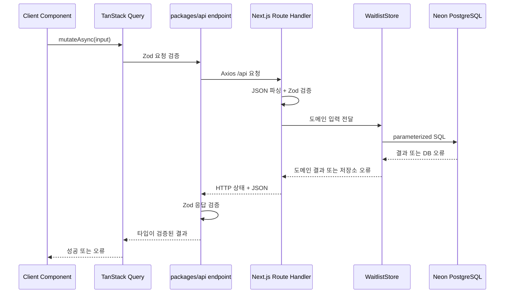

# API와 데이터 규칙

이 문서는 Checkergie Web의 API 계약, 브라우저 요청, Route Handler, 서버 저장소, DB 사이의 경계를 설명한다. 현재 대기 등록 기능을 기준 구현으로 사용한다.

## 계층과 책임



| 계층 | 위치 | 책임 |
| --- | --- | --- |
| 스키마 | `packages/api/src/schemas` | 외부 입력·응답 계약과 파생 타입 |
| endpoint | `packages/api/src/endpoints` | URL, HTTP 호출, 요청·응답 검증 |
| Query 어댑터 | `packages/api/src/query` | QueryClient 기본값, query/mutation hook |
| Route Handler | `apps/*/src/app/api` | HTTP 입력 파싱, 도메인 호출, 상태 코드 변환 |
| 저장소 계약 | `apps/*/src/server` | 앱 도메인이 필요한 저장 연산 정의 |
| 인프라 구현 | `apps/*/src/server` | DB 드라이버, SQL, 인프라 오류 분류 |

Route Handler에서 SQL을 직접 작성하지 않고, 브라우저 endpoint에서 DB 드라이버를 import하지 않는다.

## 계약 작성 규칙

- 요청과 응답의 단일 원본은 Zod 스키마다.
- TypeScript 타입은 `z.infer`로 생성한다.
- 클라이언트와 Route Handler가 같은 스키마를 사용하더라도 양쪽 경계에서 각각 검증한다.
- 성공 응답과 알려진 오류 응답은 안정적인 구조를 유지한다.
- 새 필드는 optional·nullable 의미와 하위 호환성을 먼저 결정한다.
- 화면 문구를 오류 식별자로 사용하지 않고 `code`를 사용한다.

```ts
export const waitlistErrorResponseSchema = z.object({
  code: z.literal("ALREADY_REGISTERED"),
});
```

## HTTP 상태 기준

| 상태 | 사용 기준 | 현재 예시 |
| --- | --- | --- |
| `200` | 요청이 정상 처리됨 | 신규 등록, 프로필 저장 |
| `204` | 반환 데이터 없는 성공 | DB warm-up |
| `400` | JSON 또는 입력 스키마가 잘못됨 | 잘못된 이메일, 허용되지 않은 설문 값 |
| `409` | 현재 리소스 상태와 충돌 | 이미 등록된 이메일 |
| `500` | 설정 오류, 코드 오류, 비일시적 DB 오류 | `DATABASE_URL` 누락 |
| `503` | 재시도할 수 있는 일시적 저장소 장애 | DB 연결·자원·재시도 오류 |

클라이언트는 알려진 `409`를 일반 장애와 구분한다. 알 수 없는 `500`과 `503`은 내부 내용을 노출하지 않고 사용자에게 재시도 가능한 일반 메시지를 보여준다.

## 대기 등록 데이터 모델

```sql
CREATE TABLE waitlist (
  email           VARCHAR(254) PRIMARY KEY,
  age_group       VARCHAR(16)  NULL
                  CHECK (age_group IN ('10대', '20대', '30대', '40대', '50대 이상')),
  gender          VARCHAR(16)  NULL
                  CHECK (gender IN ('여성', '남성', '기타')),
  policy_version  VARCHAR(32)  NOT NULL,
  consented_at    TIMESTAMPTZ  NOT NULL DEFAULT CURRENT_TIMESTAMP,
  created_at      TIMESTAMPTZ  NOT NULL DEFAULT CURRENT_TIMESTAMP
);
```

- 이메일은 trim 후 소문자로 정규화하고 기본 키로 사용한다.
- DB 유일성 제약이 동시 요청에서도 중복 생성을 막는 최종 기준이다.
- 연령대와 성별은 선택값이며 명시적인 해제는 `NULL`로 저장한다.
- 시점은 `TIMESTAMPTZ`로 저장하고 표시·집계 계층에서 필요한 시간대로 변환한다.
- 개인정보처리방침 시행일을 `policy_version`으로 기록한다. 이 값은 화면에 표시되는 실제 방침과 항상 같아야 한다.

### 스키마 변경

현재 `schema.sql`은 빈 환경에 테이블을 처음 만드는 스키마다. 운영 데이터가 생긴 뒤에는 파일의 `CREATE TABLE`만 수정하거나 테이블을 재생성하지 않는다.

1. 기존 데이터를 보존하는 `ALTER TABLE` 또는 migration을 작성한다.
2. 새 코드와 구 스키마가 함께 존재할 수 있는 배포 순서를 정한다.
3. 개발·Preview·Production 환경에 같은 순서로 적용한다.
4. 적용 결과와 rollback 방법을 PR에 기록한다.

migration 도구를 도입하기 전까지도 실행한 SQL과 적용 환경을 이슈 또는 PR에 남긴다.

## 등록 흐름

### 신규 이메일

1. 사용자가 이메일을 입력한다.
2. 클라이언트와 Route Handler가 형식·길이를 검증한다.
3. 저장소가 정규화한 이메일·방침 버전과 신청 확인 메일 작업을 단일 SQL로 함께 저장한다. 메일 작업 저장이 실패하면 신청도 rollback된다.
4. insert 성공 시 완료 화면과 선택 설문을 연다.
5. 설문 저장 시 연령대·성별을 update한다.
6. 응답 후 Next.js `after()`가 해당 신청자의 확인 메일 1건을 발송한다. SMTP 장애는 이미 저장된 신청을 실패로 바꾸지 않는다. 실패 작업은 대기열에 남는다. 일시적인 SMTP 거절만 정기 worker가 재처리하며, 영구 거절·결과 미확인은 운영자가 확인한다.

### 중복 이메일

1. `ON CONFLICT (email) DO NOTHING`으로 기존 행을 변경하지 않는다.
2. Route Handler는 `409 ALREADY_REGISTERED`를 반환한다.
3. UI는 장애 화면 대신 “이미 등록되어 있어요” 완료 상태를 보여준다.
4. 기존 응답을 변경하지 않도록 설문 모달과 수정 버튼을 표시하지 않는다.

이 처리는 등록 결과를 사용자에게 알려주는 안전한 fallback이지 완전한 멱등성은 아니다. 최초 insert 후 응답이 유실되면 재시도에서 등록 완료는 확인할 수 있지만 최초 설문 흐름은 복구하지 못한다.

정확한 재처리가 필요해지면 클라이언트가 생성한 idempotency key를 저장하고 같은 key의 요청에만 최초 결과를 재현한다. “최근 N분” 같은 시간 조건만으로 동일 요청을 추정하지 않는다.

## 선택 설문 상태

현재 설문 수정은 새로고침 전 같은 브라우저 세션에서만 지원한다.

- UI 편집 상태는 `undefined`를 사용한다.
- API 전송 시 선택하지 않은 값을 `null`로 변환한다.
- 마지막 저장 성공값을 모달의 기준값으로 보관한다.
- 현재 선택과 기준값이 다를 때만 저장 버튼을 활성화한다.
- 저장하지 않고 닫으면 다음 열기에서 마지막 저장 성공값으로 돌아간다.
- 모두 해제한 변경도 `null, null`로 저장할 수 있다.

현재 DB 값을 조회하는 endpoint가 없으므로 새로고침·재방문 뒤 수정은 지원하지 않는다. 향후 수정 기능은 이메일 링크 등 사용자를 확인할 수 있는 진입점과 함께 설계하고, 이메일 문자열만 받은 공개 PATCH를 장기 수정 API로 사용하지 않는다.

## DB warm-up

Neon이 유휴 상태에서 정지될 수 있어 이메일 입력 focus/input 때 `SELECT 1`을 best-effort로 요청한다.

- warm-up은 등록의 성공 조건이 아니다.
- 현재 구현은 페이지 생명주기 동안 최초 한 번만 시도한다.
- warm-up 실패는 사용자 오류로 표시하지 않고 실제 등록 요청이 DB를 다시 깨울 수 있다.
- 재시도나 시간 기반 만료를 추가할 때는 warm-up 상태와 등록 mutation 상태를 섞지 않는다.

## 환경변수

| 변수 | 노출 범위 | 필수 여부 | 용도 |
| --- | --- | --- | --- |
| `DATABASE_URL` | 서버 전용 | 런타임 필수 | Neon 연결 문자열 |
| `MAIL_WORKER_SECRET` | 서버 전용 | 복구 API 사용 시 필수 | 32자 이상 ASCII 무작위 비밀. `/api/internal/mail` POST Bearer 인증 |
| `NEXT_PUBLIC_API_BASE_URL` | 브라우저 번들 | 선택 | 별도 API origin 사용 시 지정, 기본값 `/api` |
| `NEXT_PUBLIC_GA_ID` | 브라우저 번들 | 선택 | GA4 측정 ID(`G-`로 시작). Production에만 설정하며, 없으면 GA 스크립트를 로드하지 않는다 |

- 로컬 변수는 `apps/landing/.env.local`에 두고 커밋하지 않는다.
- 서버 비밀에는 `NEXT_PUBLIC_`을 붙이지 않는다.
- `NEXT_PUBLIC_*` 값은 build 시 브라우저 번들에 고정되므로 비밀을 넣지 않는다.
- 같은 앱의 Route Handler를 호출할 때는 기본 `/api`를 사용하고 불필요한 서버 URL을 추가하지 않는다.
- CI가 DB 통합 테스트를 실행하지 않는다면 `DATABASE_URL`은 GitHub Actions가 아니라 실제 Preview·Production 런타임에 필요하다.

## 상태 관리

TanStack Query는 원격 요청 상태의 원본이다.

- query는 기본 `staleTime` 5분, 재시도 1회, window focus 자동 refetch 비활성이다.
- mutation은 자동 재시도하지 않는다. 중복 생성과 응답 유실 의미를 endpoint별로 결정해야 하기 때문이다.
- mutation pending/error 상태를 동일 의미의 지역 state와 중복 관리하지 않는다.
- 입력값, 모달 열림, 저장 전 draft처럼 서버 상태가 아닌 값만 지역 state로 둔다.

## 로그와 개인정보

- 사용자 응답과 서버 로그에 이메일, 연결 문자열, 원본 DB 오류를 불필요하게 남기지 않는다.
- 장애를 구분할 수 있도록 상태 코드와 안전한 구조화 로그를 사용한다.
- 개인정보 수집 목적·항목·보유 기간과 실제 DB 컬럼이 달라지면 `packages/docs`와 스키마를 같은 변경에서 검토한다.
- 삭제·정정 경로를 추가할 때는 UI뿐 아니라 운영 절차와 실제 데이터 삭제 확인까지 정의한다.

## 분석 이벤트

랜딩은 `@next/third-parties`의 `sendGAEvent`로 GA4에 이벤트를 보낸다. `page_view`는 GA 스크립트가 자동으로 수집한다.

| 이벤트 | 수집 시점 | 파라미터 |
| --- | --- | --- |
| `nav_click` | 헤더 강의 찾기, 루틴화, 베타 대기 클릭 | `menu`: `features` / `routine` / `waitlist`, `completed`(베타 대기만) |
| `waitlist_submit_click` | 알림 받기 클릭, Enter 제출 포함 | `form_location`: `hero`(상단) / `beta`(하단) |
| `waitlist_submit_result` | 대기 등록 제출 결과 | `form_location`, `result`: `success` / `already_registered` / `invalid` / `error` |
| `sign_up` | 대기 등록 성공 1회, 주요 이벤트 | `method`: `waitlist`, `form_location` |
| `share` | 친구에게 알려주기 클릭 | `method`: `native`(공유창) / `clipboard`(링크 복사) |
| `share_result` | 공유 결과 | `method`, `result`: `success` / `cancelled` / `error` |
| `profile_open` | 맞춤 추천 받기 클릭 | - |
| `waitlist_reset` | 다른 이메일로 신청하기 클릭 | - |
| `profile_option_click` | 설문 연령대·성별 선택 클릭 | `field`: `age_group` / `gender`, `option`, `selected` |
| `profile_submit` | 설문 저장하기 클릭 | `age_group`, `gender`, 미선택은 `none` |
| `profile_submit_result` | 설문 저장 결과 | `result`: `success` / `error` |
| `profile_skip` | 설문 건너뛰기 클릭 | - |
| `profile_dismiss` | 설문 모달을 바깥 클릭, ESC, X로 닫음 | - |
| `policy_open` | 푸터 이용약관, 개인정보처리방침 클릭 | `policy`: `terms` / `privacy` |
| `policy_close` | 이용약관, 개인정보처리방침 모달을 바깥 클릭, ESC, X로 닫음 | `policy`: `terms` / `privacy` |
| `contact_click` | 푸터 문의 메일 클릭 | - |

- 이메일 등 개인을 식별할 수 있는 값은 이벤트에 넣지 않는다. 등록 수와 이메일의 원본은 DB다.
- 이벤트 이름과 파라미터 값은 GA 보고서와 맞춤 측정기준의 기준이므로 바꾸지 않는다. 바꿔야 하면 기존 데이터와 끊긴다는 점을 PR에 적는다.
- 파라미터 값은 화면 문구가 아니라 고정 ID를 쓴다. 설문 값은 DB enum과 같은 값을 쓴다.
- GA에서 `value`, `currency`처럼 의미가 정해진 파라미터 이름은 쓰지 않는다.
- 파라미터를 추가하면 GA 관리 > 맞춤 정의에 측정기준을 먼저 등록한다. 등록 전 데이터에는 적용되지 않는다.

## 검증 시나리오

API 또는 DB 변경 PR은 정적 검사 외에 개발용 DB에서 아래를 확인한다.

| 시나리오 | 기대 결과 |
| --- | --- |
| 신규 이메일 | `200`, 행 생성, 방침 버전·동의 시각 기록 |
| 같은 이메일 재등록 | `409`, 기존 행 변화 없음 |
| 대소문자만 다른 이메일 | 같은 사용자로 중복 처리 |
| 설문 전체 저장 | 선택값 update |
| 설문 일부 해제 | 해당 컬럼 `NULL` |
| 설문 전체 해제 | 두 컬럼 모두 `NULL` |
| 미등록 이메일 프로필 요청 | 행을 새로 만들지 않음 |
| 잘못된 JSON·이메일·선택값 | `400`, DB 변화 없음 |
| `DATABASE_URL` 누락 | `500` |
| 일시적 DB 연결 실패 | `503` |

## 현재 제약과 다음 결정

다음은 현재 동작을 설명하는 제약이며, 구현된 기능으로 오해하지 않는다.

- idempotency key가 없어 최초 응답을 정확히 재현하지 못한다.
- 프로필은 같은 세션에서만 수정할 수 있고 DB 재조회가 없다.
- DB migration 도구와 자동 통합 테스트가 없다.
- 삭제 요청은 안내된 문의 채널을 통한 운영 절차에 의존한다.
- 여러 앱이 공유하는 독립 API origin은 아직 없다.

각 항목을 구현할 때는 별도 이슈로 범위와 acceptance criteria를 정하고 이 문서를 함께 갱신한다.

## 메일 발송 데이터

`mail_outbox`는 신청 확인(`welcome`)·오픈 알림(`launch`)의 작업과 결과를 저장한다. `(email, kind)` 유일성 제약과 원자적 선점으로 같은 작업의 중복 실행을 막는다. `processing` 상태로 기본 5분이 지나면 접수 여부를 알 수 없으므로 `uncertain`으로 격리한다. SMTP 성공은 수신함 도착을 보장하지 않는다.

기존 DB에는 앱 배포 전에 `apps/landing/src/server/mail/migrations/001-mail-outbox.sql`을 적용한다. 신규 DB도 `waitlist/schema.sql` 다음에 같은 migration을 적용한다. 이 migration은 기존 대기 명단을 지우거나 과거 신청자의 확인 메일을 생성하지 않는다. rollback은 이전 앱 버전으로 되돌리되 신규 테이블을 유지한다. 테이블 삭제는 대기 작업·기록을 잃으므로 일반 rollback에 포함하지 않는다.

`mail_suppressions`에 등록된 주소는 신규 선점에서 제외한다. 명단 삭제 시 외래키로 발송 작업·기록도 함께 삭제되며, 개인정보 삭제 요청은 수신 거부 테이블의 주소도 삭제해야 한다. 이미 SMTP 전송 중인 작업은 취소할 수 없다. 운영 명령과 상태별 복구는 [메일 운영](./email.md)을 따른다.

메일의 재시도 가능 여부(`retryable`)와 안전한 실패 코드(`failure_code`)를 접수 상태와 함께 보존한다. SMTP 4xx만 자동 재시도하고 5xx·설정 오류·결과 미확인은 제외한다. 실행 주체는 opt-in GitHub Actions 복구 작업이며 구체적인 설정·정책 기본값·수동 처리 범위는 `docs/email.md`에서 관리한다.

오픈 알림 자동 실행은 Production의 `MAIL_LAUNCH_AT` 예약 시각을 기준으로 한다. 값이 없으면 비활성이며, 시각 이후에만 해당 시각까지 신청한 명단을 유일성 제약으로 대기열에 추가한다. 인증된 `/api/internal/mail/launch`와 기존 확인 메일 복구 경로는 같은 정기 작업이 호출한다. 상세 처리 수·실행 예산·수동 작업 구분은 `docs/email.md`를 따른다.
