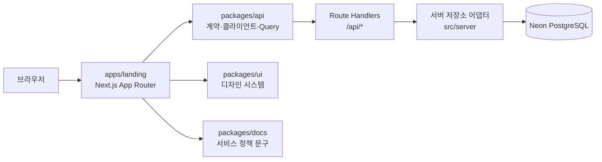

# Checkergie Web 아키텍처

이 문서는 Checkergie Web의 현재 구조와 확장 기준을 설명한다. 새 코드를 어디에 둘지, 앱과 패키지가 무엇을 소유하는지 판단할 때 기준으로 사용한다.

## 현재 범위

Checkergie Web은 pnpm workspace 기반 모노레포다. 현재 실제 제품 기능은 `apps/landing`에 구현되어 있고, `apps/admin`은 확장을 위한 스캐폴드 상태다. 루트 `pnpm check`와 CI도 랜딩 앱을 기준으로 동작한다.



## 워크스페이스 책임

| 위치 | 책임 | 두지 않는 것 |
| --- | --- | --- |
| `apps/landing` | 랜딩 라우트, 페이지 조합, 랜딩 전용 UI, Route Handler, 랜딩이 소유한 서버 구현 | 다른 앱도 재사용해야 하는 디자인 시스템 컴포넌트 |
| `apps/admin` | 관리자 앱의 라우트와 화면 | 랜딩 앱 내부 모듈에 대한 직접 의존 |
| `packages/ui` | 제품 공용 UI, 접근성 동작, 토큰, Storybook | 특정 페이지의 섹션·문구·업무 흐름 |
| `packages/api` | 공유 요청·응답 스키마, API 클라이언트, 응답 검증, TanStack Query 어댑터 | DB 연결, Route Handler, 앱 전용 저장소 구현 |
| `packages/docs` | 화면에 노출되는 이용약관·개인정보처리방침 데이터 | 개발 및 협업 문서 |
| `docs` | 아키텍처, 코드 규칙, 디자인 시스템, Git 협업 문서 | 런타임에 번들되는 서비스 문구 |

## 의존 방향

기본 의존 방향은 앱에서 패키지로 한 방향이다.

```text
apps/landing ─┬─> packages/ui
              ├─> packages/api
              └─> packages/docs

apps/admin ───┬─> packages/ui
              └─> packages/api
```

- 워크스페이스 패키지는 `apps/*`에서 코드를 가져오지 않는다.
- 한 앱은 다른 앱의 `src`를 직접 import하지 않는다.
- 패키지 간 의존이 필요하면 공개 export와 `package.json` 의존성을 명시한다.
- 같은 앱 내부의 서버 코드는 `src/server`에 두고 Client Component에서 import하지 않는다.
- `packages/api`는 이름과 달리 백엔드 서버가 아니다. 현재는 API 계약과 브라우저 통신 계층을 공유한다.

## Next.js 런타임 경계

### App Router

- 공개 페이지와 레이아웃은 `src/app`에서 관리한다.
- `page.tsx`와 `layout.tsx`는 기본적으로 Server Component다.
- 브라우저 상태, 이벤트, effect가 필요한 가장 작은 경계에만 `"use client"`를 둔다.
- Route Handler는 `src/app/api/**/route.ts`에 두고 Web `Request`·`Response` API를 사용한다.
- Pages Router API와 `next/head`를 새로 도입하지 않는다.
- Next.js 16의 `cookies()`, `headers()`, `params`, `searchParams`는 비동기 API로 취급한다.

### 현재 랜딩 경계

`app/page.tsx`는 서버 진입점이고, `LandingPageContainer`부터 대기 등록을 위한 Client Component 경계가 시작된다. `QueryProvider`는 루트 레이아웃에 있지만 서버에서 렌더링 가능한 자식까지 Client Component로 바꾸지는 않는다.

새 기능은 페이지 전체를 Client Component로 올리기 전에 다음 순서로 나눈다.

1. 서버에서 고정 콘텐츠와 데이터 조합을 처리한다.
2. 이벤트가 필요한 작은 컴포넌트만 Client Component로 만든다.
3. API 호출과 화면 상태를 연결하는 컨테이너를 둔다.
4. 표현 컴포넌트에는 가능한 한 데이터와 콜백만 전달한다.

## 앱 내부 배치 기준

```text
apps/landing/src/
├── app/          # 라우트, 레이아웃, metadata, Route Handler
├── components/   # 랜딩 전용 화면·기능 컴포넌트
└── server/       # DB, 외부 서버 자원, 저장소 어댑터
```

- URL과 직접 연결되는 진입점은 `app`에 둔다.
- 한 화면에서만 쓰는 UI와 흐름은 앱의 `components`에 둔다.
- 공용 UI 후보는 재사용 횟수만으로 이동하지 않는다. 제품 전반에서 동일한 API·접근성·상태 계약을 가져야 할 때 `packages/ui`로 옮긴다.
- DB 드라이버와 비밀 환경변수 접근은 `server` 또는 Route Handler 밖으로 노출하지 않는다.
- 서버 저장소는 인터페이스와 구현을 분리해 인프라 변경이 Route Handler에 번지지 않게 한다.

## 상태 소유권

상태는 한 곳에서만 원본으로 관리한다.

| 상태 | 소유 위치 |
| --- | --- |
| 서버에서 읽은 원격 데이터와 요청 상태 | TanStack Query |
| 입력 중인 값, 모달 열림, 현재 세션의 임시 선택 | 해당 기능의 가장 가까운 Client Component |
| URL로 공유·복원되어야 하는 필터와 탐색 상태 | App Router URL (`params`, `searchParams`) |
| 영속 데이터 | 서버와 DB |

TanStack Query의 mutation 상태와 별도의 `submitting` 상태를 동시에 원본으로 만들지 않는다. UI 전용 전환 상태가 별도로 필요하면 이름과 종료 조건을 구분한다.

두 개 이상의 boolean 조합이 유효하지 않은 상태를 만들기 시작하면 문자열 union 또는 명시적인 상태 객체로 전환한다.

```ts
type RegistrationStatus = "idle" | "submitting" | "created" | "already-registered" | "failed";
```

## 다중 앱 확장 기준

현재 API 클라이언트의 기본 주소 `/api`는 호출한 앱과 같은 origin을 뜻한다. 따라서 `apps/admin`에서 같은 클라이언트를 사용한다고 해서 랜딩의 Route Handler가 자동으로 호출되지는 않는다.

관리자 앱이 실제 데이터를 사용하기 시작할 때는 다음 중 하나를 명시적으로 결정한다.

1. 각 앱이 자신이 소유한 Route Handler를 제공한다.
2. 공용 백엔드 origin을 두고 `NEXT_PUBLIC_API_BASE_URL` 또는 서버 프록시로 연결한다.
3. 공용 서버 도메인 로직을 별도 workspace package로 추출하되, DB 드라이버와 배포 책임은 앱 또는 서버 서비스가 가진다.

결정 전까지 `apps/admin`이 `apps/landing/src/server`를 import하는 방식은 사용하지 않는다.

## 검증 범위

- 루트 `pnpm check`: 랜딩 lint, typecheck, production build
- `pnpm check:ui`: UI lint, typecheck, Storybook build
- 스캐폴드 패키지는 구현이 생기기 전까지 루트 검사 범위를 무리하게 넓히지 않는다.
- API와 DB 변경은 정적 검사와 별개로 개발용 DB에서 성공·실패 흐름을 확인한다.

세부 API·DB 흐름은 [API와 데이터 규칙](./api-and-data.md), 구현 문법은 [코드 작성 규칙](./code-convention.md), UI는 [디자인 시스템](./design-system.md)을 따른다.
